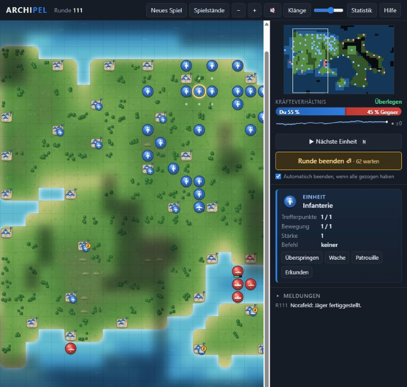

# Archipel

Rundenbasiertes Eroberungsspiel im Stil der klassischen Strategiespiele der 80er:
eine zufällige Inselwelt im Nebel des Krieges, Städte erobern, Einheiten bauen,
Truppen per Schiff übersetzen – gegen einen Computergegner.

Läuft komplett im Browser, ohne Installation und ohne externe Bibliotheken.
Grafik und Klänge werden im Programm erzeugt, es gibt keine Bild- oder Audiodateien.

*English:* a turn-based island conquest game in the spirit of the classic 80s strategy games – explore,
capture cities, build units and ship your troops across the sea against a computer opponent. The game
is available in English: use the language button in the top bar.

*Landung im Inselreich, Runde 71:* Dein Schlachtschiff liegt vor der feindlichen Stadt Maristad und hält
sie unter Feuer – die Eckwinkel um die Stadt zeigen es, und die Seitenleiste nennt die Wirkung: Sie fällt
jetzt zu 75 % statt zu 50 %. Daneben wartet ein Transporter mit zwei weiteren Truppen, an Land stehen
Infanterie und Panzer zum Sturm bereit, feindliche Truppen (rot) halten dagegen. Der Träger links
(gestrichelter Ring) überblickt das Seegebiet und schützt mit seinem Jäger an Bord die Flotte vor
Luftangriffen. Rechts oben die Übersichtskarte mit den Inseln, darunter das Kräfteverhältnis.

*The scene:* a landing in the archipelago. Your battleship lies off the enemy city of Maristad and gives
fire support (corner brackets; the city now falls 75 % of the time instead of 50 %), a transport brings
more troops, and the carrier on the left watches the sea and shields the fleet from air attacks.

## Spielen

Direkt im Browser: **https://masa3418.github.io/archipel/**

Oder lokal: `index.html` doppelklicken. Das Spiel speichert nach jeder Runde automatisch im Browser;
über **Spielstände** lassen sich beliebig viele benannte Stände anlegen und als Datei
exportieren. Das **Handbuch** (Knopf **Hilfe** oder Taste `H`) erklärt in sechs Reitern erste Schritte, Einheiten,
Kampf, Steuerung und den Gegner.

## Inhalt

- Deutsch und Englisch (Sprachknopf oben in der Leiste)
- Zufällige Karten in drei Größen und drei Weltarten (Inselreich, Gemischt, Kontinente) mit Wäldern und Bergen
- Nebel des Krieges, Städte erobern (50 % Chance, der Eroberer geht in der Stadt auf) und Produktion wählen
- Neun Einheiten: Infanterie, Panzer, Jäger (mit Treibstoff), Transporter, Zerstörer,
  U-Boot, Kreuzer, Träger, Schlachtschiff
- Stärken und Schwächen (Torpedo, Sonar, Wasserbomben, Küstenbatterien, Luftangriffe,
  Feuerunterstützung durch Schlachtschiffe, getarnte U-Boote, Luftdeckung durch Träger),
  die angezeigte Siegchance berücksichtigt sie
- Befehle: Marsch, Wache, Patrouille, Erkunden, Heimkehr, Ein-/Ausladen – auch über ein Rechtsklick-Menü
- Computergegner in vier Schwierigkeitsstufen; auf Leicht/Normal muss er die Karte
  wie du erkunden und macht gelegentlich Fehler, auf Schwer/Brutal spielt er umsichtiger
  (Geleitschutz, lauernde U-Boote, Träger)
- Handbuch im Spiel mit Einheitenkarten und einer Tabelle „Wer schlägt wen“, die sich aus den Regeln selbst berechnet
- Animationen, Kamerafahrten bei Gegnerzügen, Kräfteverhältnis, Statistik
- Synthetisierte Soundeffekte und Klangteppiche je Einheitentyp, Klangtest-Fenster

## Aufbau

| Datei | Inhalt |
|---|---|
| `index.html` | Seite, Stile, Dialoge |
| `js/data.js` | Sprache, Einheitentypen, Weltarten, Schwierigkeitsgrade (hier lässt sich das Balancing ändern) |
| `js/map.js` | Kartengenerator, Städte, Startpositionen |
| `js/game.js` | Spielregeln: Bewegung, Kampf, Eroberung, Produktion, Sicht, Wegsuche, Speichern |
| `js/ai.js` | Computergegner |
| `js/gfx.js` | Grafik: Gelände, Städte, Einheiten-Symbole |
| `js/sfx.js` | Klänge (Web Audio) |
| `js/ui.js` | Darstellung, Animationen, Bedienung, Seitenleiste, Dialoge, Handbuch |
| `tools/serve.js` | Kleiner lokaler Webserver nur für die Entwicklung (`node tools/serve.js .`) |

## Datenschutz

- **Keine Cookies, kein Tracking, keine Analyse-Dienste.**
- **Keine externen Inhalte:** Das Spiel lädt nichts von anderen Servern – auch keine Schriften
  oder Bibliotheken.
- **Speicherung nur lokal:** Spielstände und Einstellungen liegen im Browser (localStorage) und
  verlassen den Rechner nicht, außer man exportiert selbst eine Datei.
- **Hosting:** Die Online-Version liegt auf GitHub Pages. GitHub verarbeitet dabei technisch
  notwendige Daten wie die IP-Adresse, siehe
  [Datenschutzerklärung von GitHub](https://docs.github.com/de/site-policy/privacy-policies/github-general-privacy-statement).

## Mitmachen

Fehler, Ideen und Balancing-Rückmeldungen sind willkommen – siehe
[CONTRIBUTING.md](CONTRIBUTING.md) und den [Verhaltenskodex](CODE_OF_CONDUCT.md).
Sicherheitslücken bitte vertraulich melden: [SECURITY.md](SECURITY.md).

## Lizenz

MIT – siehe [LICENSE](LICENSE).
