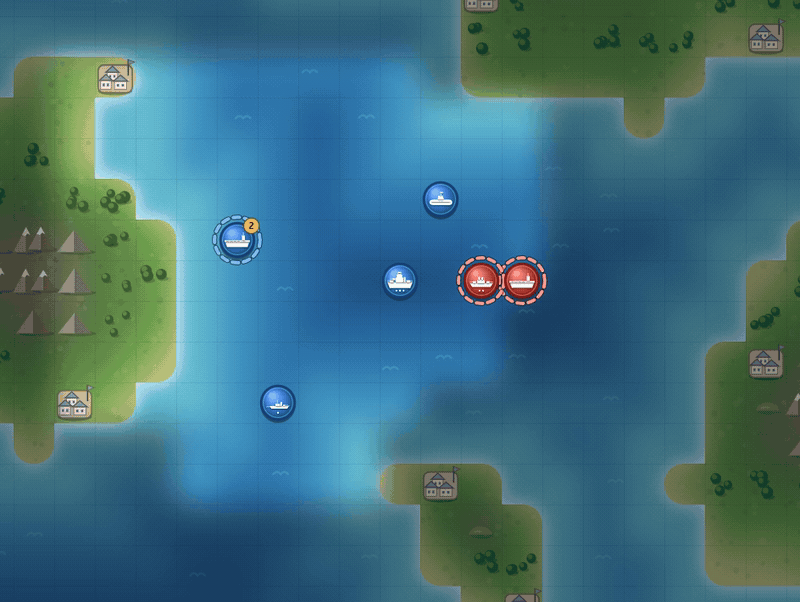

# Archipel

Rundenbasiertes Eroberungsspiel im Stil der klassischen Strategiespiele der 80er:
eine zufällige Inselwelt im Nebel des Krieges, Städte erobern, Einheiten bauen,
Truppen per Schiff übersetzen – gegen einen Computergegner.

Läuft komplett im Browser, ohne Installation und ohne externe Bibliotheken – [online](https://masa3418.github.io/archipel/) oder als
[einzelne Datei zum Herunterladen](https://github.com/masa3418/archipel/releases/latest) auch ganz ohne Internet.
Grafik und Klänge werden im Programm erzeugt, es gibt keine Bild- oder Audiodateien.

*English:* a turn-based island conquest game in the spirit of the classic 80s strategy games – explore,
capture cities, build units and ship your troops across the sea against a computer opponent. The game
is available in English: use the language button in the top bar. Play it
[online](https://masa3418.github.io/archipel/) or download the single-file
[offline copy](https://github.com/masa3418/archipel/releases/latest) and double-click it.

*Seeschlacht im Inselreich* ([als Video mit Ton](docs/seeschlacht.mp4)): Deine Flotte (blau) trifft auf einen
feindlichen Verband. Dein Zerstörer ortet das getauchte U-Boot und versenkt es. Ein Jäger von deinem Träger greift
den Kreuzer an – doch der feindliche Träger gibt Luftdeckung, seine Abfangjäger schießen ihn ab. Dann torpediert dein
U-Boot den Träger, und dein Schlachtschiff versenkt den Kreuzer, der jetzt ohne Schutz dasteht.

*The scene:* a sea battle in the archipelago ([video with sound](docs/seeschlacht.mp4)). Your destroyer locates and
sinks a submerged submarine, a fighter is shot down by the enemy carrier's air cover, then your submarine torpedoes
the carrier and your battleship sinks the now unprotected cruiser.

## Spielen

- **Online:** https://masa3418.github.io/archipel/
- **Offline:** Unter [Releases](https://github.com/masa3418/archipel/releases/latest) die Datei `archipel.html`
  herunterladen und doppelklicken. Das ganze Spiel steckt in dieser einen Datei; es wird nichts installiert und
  keine Internetverbindung gebraucht. Wer lieber einzelne Dateien hat, nimmt `archipel-offline.zip`.
- **Aus dem Quelltext:** Repository herunterladen und `index.html` doppelklicken.

Das Spiel speichert nach jeder Runde automatisch im Browser; über **Spielstände** lassen sich beliebig viele
benannte Stände anlegen und als Datei exportieren. Online- und Offline-Fassung haben getrennte Spielstände – per
Export und „Aus Datei laden“ wandern sie von der einen zur anderen. Das **Handbuch** (Knopf **Hilfe** oder Taste `H`)
erklärt in sechs Reitern erste Schritte, Einheiten, Kampf, Steuerung und den Gegner.

## Inhalt

- Deutsch und Englisch (Sprachknopf oben in der Leiste)
- Zufällige Karten in drei Größen und drei Weltarten (Inselreich, Gemischt, Festland mit Binnenmeeren und Flüssen) mit Wäldern und Bergen
- Nebel des Krieges, Städte erobern (50 % Chance, der Eroberer geht in der Stadt auf) und Produktion wählen
- Neun Einheiten: Infanterie, Panzer, Jäger (mit Treibstoff), Transporter, Zerstörer,
  U-Boot, Kreuzer, Träger, Schlachtschiff
- Stärken und Schwächen (Torpedo, Sonar, Wasserbomben, Küstenbatterien, Luftangriffe,
  Feuerunterstützung durch Schlachtschiffe, getarnte U-Boote, Luftdeckung durch Träger),
  die angezeigte Siegchance berücksichtigt sie
- Befehle: Marsch, Wache, Patrouille, Erkunden, Heimkehr, Ein-/Ausladen – auch über ein Rechtsklick-Menü
- Computergegner in vier Schwierigkeitsstufen; auf Leicht/Normal muss er die Karte
  wie du erkunden und macht gelegentlich Fehler, auf Schwer/Brutal spielt er umsichtiger
  (Geleitschutz, lauernde U-Boote, Träger)
- Handbuch im Spiel mit Einheitenkarten und einer Tabelle „Wer schlägt wen“, die sich aus den Regeln selbst berechnet
- Animationen, Kamerafahrten bei Gegnerzügen, Kräfteverhältnis, Statistik
- Bedienung mit Maus, Tastatur und Touchpad
- Offline-Fassung als einzelne Datei, siehe [Änderungen je Version](CHANGELOG.md)
- Synthetisierte Soundeffekte und Klangteppiche je Einheitentyp, Klangtest-Fenster

## Aufbau

| Datei | Inhalt |
|---|---|
| `index.html` | Seite, Stile, Dialoge |
| `js/data.js` | Sprache, Einheitentypen, Weltarten, Schwierigkeitsgrade (hier lässt sich das Balancing ändern) |
| `js/map.js` | Kartengenerator, Städte, Startpositionen |
| `js/game.js` | Spielregeln: Bewegung, Kampf, Eroberung, Produktion, Sicht, Wegsuche, Speichern |
| `js/ai.js` | Computergegner |
| `js/gfx.js` | Grafik: Gelände, Städte, Einheiten-Symbole |
| `js/sfx.js` | Klänge (Web Audio) |
| `js/ui.js` | Darstellung, Animationen, Bedienung, Seitenleiste, Dialoge, Handbuch |
| `tools/serve.js` | Kleiner lokaler Webserver nur für die Entwicklung (`node tools/serve.js .`) |
| `tools/pack.js` | Verpackt die Offline-Fassung für einen Release (läuft automatisch auf GitHub) |
| `CHANGELOG.md` | Änderungen je Version |

## Datenschutz

- **Keine Cookies, kein Tracking, keine Analyse-Dienste.**
- **Keine externen Inhalte:** Das Spiel lädt nichts von anderen Servern – auch keine Schriften
  oder Bibliotheken.
- **Speicherung nur lokal:** Spielstände und Einstellungen liegen im Browser (localStorage) und
  verlassen den Rechner nicht, außer man exportiert selbst eine Datei.
- **Hosting:** Die Online-Version liegt auf GitHub Pages. GitHub verarbeitet dabei technisch
  notwendige Daten wie die IP-Adresse, siehe
  [Datenschutzerklärung von GitHub](https://docs.github.com/de/site-policy/privacy-policies/github-general-privacy-statement).

## Mitmachen

Fehler, Ideen und Balancing-Rückmeldungen sind willkommen – siehe
[CONTRIBUTING.md](CONTRIBUTING.md) und den [Verhaltenskodex](CODE_OF_CONDUCT.md).
Sicherheitslücken bitte vertraulich melden: [SECURITY.md](SECURITY.md).

## Lizenz

MIT – siehe [LICENSE](LICENSE).
